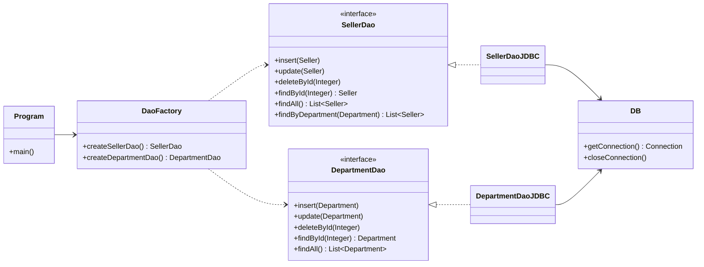

<h1 align="center">demoDaoJDBC</h1>

<p align="center">
  Implementação do padrão <strong>DAO (Data Access Object)</strong> em Java puro com <strong>JDBC</strong> e <strong>MySQL</strong>.
</p>

<p align="center">
  
  
  
  
</p>

---

## Sobre o projeto

Este projeto demonstra como separar a lógica de acesso a dados das regras de negócio usando o padrão **DAO**, sem frameworks de persistência (sem JPA, sem Hibernate) — apenas a API JDBC nativa do Java.

O domínio é simples: **vendedores** (`Seller`) que pertencem a um **departamento** (`Department`). Para cada entidade existe uma interface DAO com as operações de CRUD e uma implementação JDBC concreta, instanciada através de uma **fábrica** (`DaoFactory`).

### Conceitos aplicados

- Padrão de projeto **DAO** com interfaces e implementações desacopladas
- Padrão **Factory** para injeção da implementação (`DaoFactory`)
- `PreparedStatement` com parâmetros (proteção contra SQL Injection)
- Recuperação de chaves geradas com `Statement.RETURN_GENERATED_KEYS`
- Mapeamento manual de `ResultSet` para objetos (`instantiateSeller`, `instantiateDepartment`)
- Reaproveitamento de instâncias com `Map` para evitar objetos duplicados de `Department` em consultas com `JOIN`
- Exceções personalizadas não verificadas (`DbException`, `DbIntegrityException`)
- Configuração externa de conexão via arquivo `.properties`

---

## Arquitetura



A aplicação conhece apenas as **interfaces** (`SellerDao`, `DepartmentDao`) e a `DaoFactory`. Trocar o JDBC por outra tecnologia exigiria apenas uma nova implementação e uma alteração na fábrica.

---

## Estrutura de pastas

```
demoDaoJDBC/
├── src/
│   ├── application/
│   │   ├── Program.java              # Testes do SellerDao
│   │   └── Program2.java             # Testes do DepartmentDao
│   ├── db/
│   │   ├── DB.java                   # Gerencia conexão e fechamento de recursos
│   │   ├── DbException.java          # Exceção genérica de acesso a dados
│   │   └── DbIntegrityException.java # Exceção para violação de integridade
│   └── model/
│       ├── dao/
│       │   ├── DaoFactory.java
│       │   ├── DepartmentDao.java
│       │   ├── SellerDao.java
│       │   └── impl/
│       │       ├── DepartmentDaoJDBC.java
│       │       └── SellerDaoJDBC.java
│       └── entities/
│           ├── Department.java
│           └── Seller.java
├── db.properties.example             # Modelo de configuração do banco
└── README.md
```

---

## Operações disponíveis

| Operação             | `SellerDao` | `DepartmentDao` |
|----------------------|:-----------:|:---------------:|
| `insert`             | Sim         | Sim             |
| `update`             | Sim         | Sim             |
| `deleteById`         | Sim         | Sim             |
| `findById`           | Sim         | Sim             |
| `findAll`            | Sim         | Sim             |
| `findByDepartment`   | Sim         | —               |

---

## Como executar

### Pré-requisitos

- **JDK 25**
- **MySQL** em execução (local ou remoto)
- **Driver JDBC do MySQL** (MySQL Connector/J) — [download oficial](https://dev.mysql.com/downloads/connector/j/)
- IntelliJ IDEA (recomendado)

### 1. Clonar o repositório

```bash
git clone <url-do-repositorio>
cd demoDaoJDBC
```

### 2. Criar o banco de dados

O projeto espera as tabelas `department` e `seller`. Um script de referência, compatível com as consultas da aplicação:

```sql
CREATE DATABASE application;
USE application;

CREATE TABLE department (
  Id   INT          NOT NULL AUTO_INCREMENT,
  Name VARCHAR(60)  DEFAULT NULL,
  PRIMARY KEY (Id)
);

CREATE TABLE seller (
  Id           INT           NOT NULL AUTO_INCREMENT,
  Name         VARCHAR(60)   NOT NULL,
  Email        VARCHAR(100)  NOT NULL,
  BirthDate    DATETIME      NOT NULL,
  BaseSalary   DOUBLE        NOT NULL,
  DepartmentId INT           NOT NULL,
  PRIMARY KEY (Id),
  FOREIGN KEY (DepartmentId) REFERENCES department (Id)
);

INSERT INTO department (Name) VALUES
  ('Computers'), ('Electronics'), ('Fashion'), ('Books');
```

> Os nomes do banco e das colunas podem ser ajustados, desde que as consultas em `model/dao/impl` sejam mantidas coerentes.

### 3. Configurar a conexão

Copie o arquivo de exemplo e preencha com seus dados:

```bash
cp db.properties.example db.properties
```

```properties
user=seu_usuario
password=sua_senha
dburl=jdbc:mysql://localhost:3306/coursejdbc
useSSL=false
```

> O `db.properties` está no `.gitignore` e **não deve ser versionado**, pois contém credenciais.

### 4. Adicionar o driver JDBC

No IntelliJ: **File > Project Structure > Libraries > + > Java** e selecione o `.jar` do MySQL Connector/J.

### 5. Rodar os testes

- `src/application/Program.java` — executa o CRUD completo de **vendedores**
- `src/application/Program2.java` — executa o CRUD completo de **departamentos**

Exemplo de saída do `Program2`:

```
===TEST 1: department findById===
Department{id=1, name='Computers'}

===TEST 2: department findByAll===
...

===TEST 3: department insert===
Inserted! New id = 5

===TEST 4: department update===
Update completed!

===TEST 5: department delete===
Enter id for delete test:
```

> Os testes de `insert`, `update` e `delete` **alteram dados reais** do banco. Use um banco de desenvolvimento.

---

## Exemplo de uso

```java
SellerDao sellerDao = DaoFactory.createSellerDao();

// Buscar por id
Seller seller = sellerDao.findById(3);

// Listar vendedores de um departamento
List<Seller> list = sellerDao.findByDepartment(new Department(2, null));

// Inserir
Seller novo = new Seller(null, "Greg", "greg@example.com", new Date(), 4000.0, new Department(2, null));
sellerDao.insert(novo);
System.out.println("Novo id: " + novo.getId());
```

---
